Министерство Образования Российской Федерации

Пермский Государственный Национальный Исследовательский университет

Государственного и муниципального управления

Отчет по Лабораторной работе №1

по дисциплине:

«Язык программирования С++»

> Выполнил студент гр.ИТ-5, 2 курс

> Ершов Р.Д.

> Руководитель Ракина В.Д.

г. Пермь, 2026

# Задание 1

## Задача 2

### Текст задачи

Сумма знаков.

Дана сигнатура функции: int sumLastNums (int x);

Необходимо реализовать функцию таким образом, чтобы она возвращала
результат сложения двух последних знаков числах, предполагая, что знаков
в числе не менее двух.

Подсказки: int x=123%10; // х будет иметь значение 3

int у=123/10; // у будет иметь значение 12

Пример: x=4568 результат: 14

### Алгоритм решения

Сначала пользователь вводит целое число и программа проверяет
корректность ввода и наличие в числе как минимум двух цифр. Затем с
помощью операции % 10 определяется последняя цифра числа и сохраняется в
переменную a. Для получения предпоследней цифры число сначала берётся по
модулю 100, после чего результат делится на 10, и полученная цифра
сохраняется в переменную b. После этого значения a и b складываются, а
полученная сумма возвращается функцией и выводится на экран.

### Тестирование

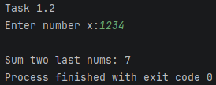

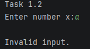

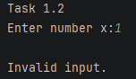

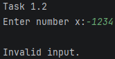

## Задача 4

### Текст задачи

Есть ли позитив.

Дана сигнатура функции: bool isPositive (intx);

Необходимо реализовать функцию таким образом, чтобы она принимала число
x и возвращала true, если оно положительное. Пример 1:

x=3

результат: true

Пример 2:

x=-5

результат: false

### Алгоритм решения

Сначала пользователь вводит целое число x, после чего программа
проверяет, является ли оно положительным. Для этого значение x
сравнивается с нулём: если x \> 0, функция возвращает true, в противном
случае возвращается false. Полученный результат выводится на экран.

### Тестирование

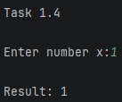

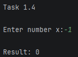

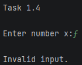

## Задача 6

### Текст задачи

Большая буква.

Дана сигнатура функции: bool isUpperCase (char x);

Необходимо реализовать функцию таким образом, чтобы она принимала символ
x и возвращала true, если это большая буква в диапазоне от ‘A’ до ‘Z’.

Пример 1: x=’D’

результат: true

Пример 2: x=’q’

результат: false

### Алгоритм решения

Сначала пользователь вводит символ x, после чего программа проверяет,
является ли введённый символ цифрой. Если это цифра, выводится сообщение
об ошибке. В противном случае функция сравнивает символ с диапазоном от
'A' до 'Z': если символ входит в этот диапазон, функция возвращает true,
иначе возвращает false. Полученный результат выводится на экран.

### Тестирование

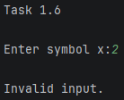

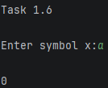

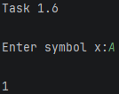

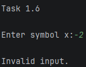

## Задача 8

### Текст задачи

Делитель.

Дана сигнатура функции: bool isDivisor (int a, int b);

Необходимо реализовать функцию таким образом, чтобы она возвращала true,
если любое из принятых чисел делит другое нацело. Пример 1: a=3 b=6

результат: true

Пример 2: a=2 b=15

результат: false

### Алгоритм решения

Сначала пользователь вводит два целых числа a и b, после чего программа
проверяет корректность их ввода. Затем функция проверяет, делится ли
число a на b нацело или число b на a нацело, используя операцию %. Если
выполняется хотя бы одно из этих условий, функция возвращает true, в
противном случае возвращает false. Полученный результат выводится на
экран.

### Тестирование

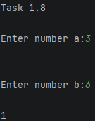

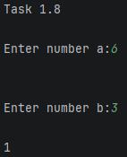

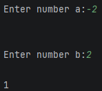

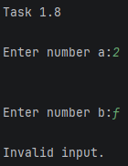

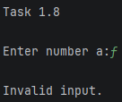

## Задача 10

### Текст задачи

Многократный вызов.

Дана сигнатура функции: int lastNumSum(int a, int b).

Необходимо реализовать функцию таким образом, чтобы она считала сумму
цифр двух чисел из разряда единиц. Выполните с его помощью
последовательное сложение пяти чисел и результат выведите на экран.
Постарайтесь выполнить задачу, используя минимально возможное количество
вспомогательных переменных.

Пример: 5+11 это 6 6+123 это 9 9+14 это 13 13+1 это 4 Итого 4

### Алгоритм решения

Сначала пользователь вводит первое число, которое сохраняется в
переменную result, а затем поочерёдно вводит ещё четыре числа, используя
одну вспомогательную переменную number.

При каждом вызове функции из обоих чисел выделяются цифры единиц с
помощью операции % 10, после чего они складываются. Полученная сумма
снова сохраняется в result и используется при следующем сложении с
очередным числом. После четырёх последовательных вызовов функции
итоговый результат выводится на экран.

### Тестирование

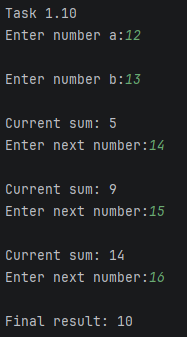

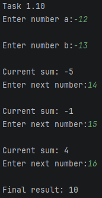

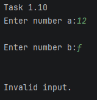

# Задание 2

## Задача 2

### Текст задачи

Безопасное деление.

Дана сигнатура функции: double safeDiv (int x, int y);

Необходимо реализовать функцию таким образом, чтобы она возвращала
деление x на y, и при этом гарантировала, что не будет выкинута ошибка
деления на 0. При делении на 0 следует вернуть из функции число 0.

Подсказка: смотри ограничения на операции типов данных.

Пример 1: x=5 y=0

результат: 0

Пример 2: x=8 y=2

результат: 4

### Алгоритм решения

Сначала пользователь вводит два целых числа x и y, после чего программа
проверяет корректность ввода. Затем функция проверяет, равен ли делитель
y нулю: если да, она возвращает 0, чтобы избежать ошибки деления на
ноль. Если y не равен нулю, значение x преобразуется в тип double, после
чего выполняется деление на y, что позволяет получить вещественный
результат. Полученный результат сохраняется в переменную result и
выводится на экран.

### Тестирование

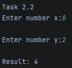

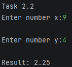

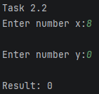

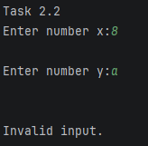

## Задача 4

### Текст задачи

Строка сравнения.

Дана сигнатура функции: String makeDecision (int x, int y); Необходимо
реализовать функцию таким образом, чтобы она возвращала строку, которая
включает два принятых функцией числа и корректно выставленный знак
операции сравнения (больше, меньше, или равно).

Пример 1: x=5 y=7

результат: “5\< 7”

Пример 2: x=8 y=-1

результат: “8 \>-1”

Пример 3: x=4 y=4

результат: “4==4”

### Алгоритм решения

Сначала пользователь вводит два целых числа x и y, после чего программа
проверяет корректность ввода. Затем функция сравнивает эти числа: если x
больше y, формируется строка со знаком \>, если x меньше y — со знаком
\<, а если числа равны — со знаком =. Для добавления чисел в строку они
преобразуются из типа int в строковый тип с помощью std::to_string.
Полученная строка возвращается функцией и выводится на экран.

### Тестирование

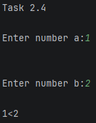

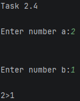

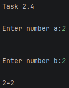

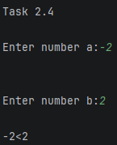

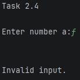

## Задача 6

### Текст задачи

Тройная сумма.

Дана сигнатура функции: bool sum3 (int x, int y, int z);

Необходимо реализовать функцию таким образом, чтобы она возвращала true,
если два любых числа (из трех принятых) можно сложить так, чтобы
получить третье.

Пример 1: x=5 y=7 z=2

результат: true

Пример 2: x=8 y=-1 z=4

результат: false

### Алгоритм решения

Сначала пользователь вводит три целых числа x, y и z, после чего
программа проверяет корректность их ввода. Затем функция проверяет все
три возможных варианта сложения двух чисел: y + z = x, z + x = y и x + y
= z. Если хотя бы одно из этих условий выполняется, функция возвращает
true, в противном случае возвращается false. Полученный результат
выводится на экран.

### Тестирование

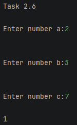

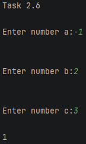

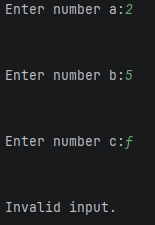

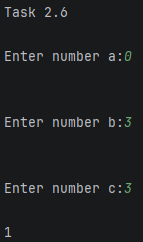

## Задача 8

### Текст задачи

Возраст.

Дана сигнатура функции: String age (int x);

Необходимо реализовать функцию таким образом, чтобы она возвращала
строку, в которой сначала будет число х, а затем одно из слов: • год •
года • лет Слово “год” добавляется, если число х заканчивается на 1,
кроме числа 11. Слово “года” добавляется, если число х заканчивается на
2, 3 или 4, кроме чисел 12, 13, 14. Слово “лет” добавляется во всех
остальных случаях.

Подсказка: оператор % позволяет получить остаток от деления. Пример 1:
x=5

результат: “5 лет”

Пример 2: x=31

результат: “31 год”

Пример 3: x=44

результат: “44 года”

### Алгоритм решения

Сначала пользователь вводит неотрицательное число x, после чего
программа проверяет корректность ввода. Затем функция определяет
последнюю цифру числа с помощью операции % 10 и учитывает исключения для
чисел 11–14.

Если число заканчивается на 1 и не равно 11, к нему добавляется слово
год; если заканчивается на 2, 3 или 4 и не относится к числам 12, 13 или
14, добавляется слово года. Во всех остальных случаях используется слово
лет. Полученная строка возвращается функцией и выводится на экран.

Тестирование: (в английском языке слова: год, года, лет – year, поэтому
пришлось обозначать «лет – let»)

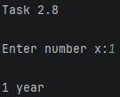

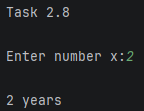

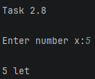

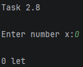

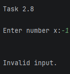

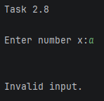

## Задача 10

### Текст задачи

Вывод дней недели.

Дана сигнатура функции: void printDays (int x);

В качестве параметра функция принимает число x, обозначаются день
недели. Необходимо реализовать функцию таким образом, чтобы она выводила
на экран название переданного в него дня и всех последующих до конца
недели дней. Если в качестве параметра передан не день (число, не в
диапазоне от 1 от 7), то выводится текст “это не день недели”. Первый
день понедельник, последний – воскресенье. Вместо if в данной задаче
используйте switch.

Пример 1: x=4

результат: четверг пятница суббота воскресенье

Пример 2: x=18

результат: это не день недели

### Алгоритм решения

Сначала пользователь вводит число x, после чего функция с помощью
конструкции switch определяет соответствующий ему день недели. Если
передано число от 1 до 7, программа выводит название этого и всех
последующих дней до воскресенья. Благодаря отсутствию break после первых
вариантов case выполнение продолжается со следующего дня недели. Если
введено число вне диапазона от 1 до 7, срабатывает default и выводится
сообщение о том, что это не день недели.

### Тестирование

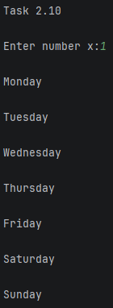

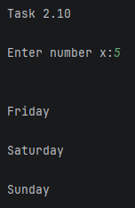

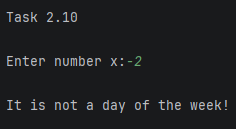

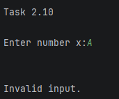

# Задание 3

## Задача 2

### Текст задачи

Числа наоборот.

Дана сигнатура функции: String reverseListNums (int x);

Необходимо реализовать функцию таким образом, чтобы она возвращала
строку, в которой будут записаны все числа от x до 0 (включительно).

Пример: x=5

результат: “5 4 3 2 1 0”

### Алгоритм решения

Сначала пользователь вводит неотрицательное число x, после чего
программа проверяет корректность ввода. Затем создаётся пустая строка
result, в которую с помощью цикла for последовательно добавляются все
числа от x до 0 в порядке убывания. Каждое число преобразуется в строку
и отделяется пробелом. После завершения цикла полученная строка
возвращается функцией и выводится на экран.

### Тестирование

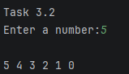

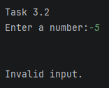

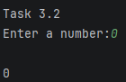

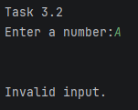

## Задача 4

### Текст задачи

Степень числа.

Дана сигнатура функции: int pow (int x, int y);

Необходимо реализовать функцию таким образом, чтобы она возвращала
результат возведения x в степень y. Подсказка: для получения степени
необходимо умножить единицу на число x, и сделать это y раз, т.е. два в
третьей степени это 1\*2\*2\*2

Пример: x=2 y=5

результат: 32

### Алгоритм решения

Сначала пользователь вводит числа x и y, после чего программа проверяет
корректность ввода. Затем создаётся переменная result, первоначально
равная 1. С помощью цикла for число x последовательно умножается на
result ровно y раз, в результате чего получается значение x в степени y.
После завершения цикла полученный результат возвращается функцией и
выводится на экран.

### Тестирование

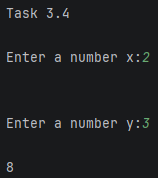

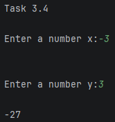

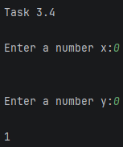

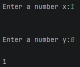

## Задача 6

### Текст задачи

Одинаковость.

Дана сигнатура функции: bool equalNum (int x);

Необходимо реализовать функцию таким образом, чтобы она возвращала true,
если все знаки числа одинаковы, и false в ином случае.

Подсказки:

intx=123%10; // х будет иметь значение 3

intу=123/10; // у будет иметь значение 12

Пример 1: x=1111

результат: true

Пример 2: x=1211

результат: false

### Алгоритм решения

Сначала пользователь вводит целое число x, после чего программа
проверяет корректность ввода. Если число отрицательное, его знак
изменяется на положительный, чтобы дальнейшая проверка выполнялась
только с цифрами. Затем с помощью % 10 определяется последняя цифра
числа и сохраняется в LastDigit, после чего последняя цифра удаляется
делением на 10. В цикле while по очереди извлекаются остальные цифры и
сравниваются с LastDigit: если хотя бы одна цифра отличается, функция
возвращает false. Если все цифры совпадают, после завершения цикла
функция возвращает true.

### Тестирование

## Задача 8

### Текст задачи

Левый треугольник.

Дана сигнатура функции: void leftTriangle (int x);

Необходимо реализовать функцию таким образом, чтобы она выводила на
экран треугольник из символов ‘\*’ у которого х символов в высоту, а
количество символов в ряду совпадает с номером строки.

Пример 1: x=2

результат: \*

\*\*

Пример 2: x=4

результат: \*

\*\*

\*\*\*

\*\*\*\*

### Алгоритм решения

Сначала пользователь вводит положительное число x, после чего программа
проверяет корректность ввода. Затем внешний цикл for последовательно
перебирает строки от 1 до x. Для каждой строки внутренний цикл выводит
символ \* столько раз, каков номер текущей строки. После завершения
внутреннего цикла выполняется переход на новую строку. В результате
получается треугольник, высота которого равна x.

### Тестирование

## Задача 10

### Текст задачи

Угадайка.

Дана сигнатура функции: void guessGame()

Необходимо реализовать функцию таким образом, чтобы она генерировала
случайное число от 0 до 9, далее считывала с консоли введенное
пользователем число и выводила, угадал ли пользователь то, что было
загадано, или нет. Функция запускается до тех пор, пока пользователь не
угадает число. После этого выведите на экран количество попыток, которое
потребовалось пользователю, чтобы угадать число.

Пример:

Введите число от 0 до 9: 5 Вы не угадали,

введите число от 0 до 9: 9 Вы угадали! Вы отгадали число за 2 попытки

### Алгоритм решения

Сначала программа генерирует случайное число от 0 до 9 и устанавливает
счётчик попыток в 0. Затем в цикле пользователь вводит предполагаемое
число, после чего счётчик попыток увеличивается на единицу. Введённое
число сравнивается со случайным: если числа совпадают, выводится
сообщение об успешном угадывании и количество попыток, после чего цикл
завершается. Если числа не совпадают, выводится сообщение о неверном
ответе, и программа продолжает запрашивать числа до тех пор, пока
пользователь не угадает загаданное число. Сначала программа генерирует
случайное число от 0 до 9 и устанавливает счётчик попыток в 0. Затем в
цикле пользователь вводит предполагаемое число, после чего счётчик
попыток увеличивается на единицу. Введённое число сравнивается со
случайным: если числа совпадают, выводится сообщение об успешном
угадывании и количество попыток, после чего цикл завершается. Если числа
не совпадают, выводится сообщение о неверном ответе, и программа
продолжает запрашивать числа до тех пор, пока пользователь не угадает
загаданное число.

### Тестирование

# Задание 4

## Задача 2

### Текст задачи

Поиск последнего значения.

Дана сигнатура функции: int findLast (int arr\[\], int x);

Необходимо реализовать функцию таким образом, чтобы она возвращала
индекс последнего вхождения числа x в массив arr. Если число не входит в
массив – возвращается -1.

Пример: arr=\[1,2,3,4,2,2,5\] x=2

результат: 5

### Алгоритм решения

Сначала пользователь вводит 7 элементов массива и число x, которое
необходимо найти. Затем переменная lastIndex устанавливается в -1, что
означает отсутствие числа x в массиве. С помощью цикла программа
последовательно проверяет все элементы массива, и если текущий элемент
равен x, его индекс сохраняется в lastIndex. При повторных совпадениях
значение индекса обновляется, поэтому после завершения цикла в
переменной остаётся индекс последнего вхождения числа x. Если совпадений
не найдено, функция возвращает -1.

### Тестирование

## Задача 4

### Текст задачи

Добавление в массив.

Дана сигнатура функции: int \* add (int arr\[\], int x, int pos);

Необходимо реализовать функцию таким образом, чтобы она возвращала новый
массив, который будет содержать все элементы массива arr, однако в
позицию pos будет вставлено значение x. Пример: arr=\[1,2,3,4,5\] x=9
pos=3

результат: \[1,2,3,9,4,5\]

### Алгоритм решения

Сначала пользователь вводит 5 элементов массива, число x и позицию pos,
после чего программа проверяет корректность введённых данных.

Затем создаётся новый массив размером на один элемент больше исходного.
Сначала в него копируются элементы исходного массива до указанной
позиции, затем на эту позицию помещается значение x, а оставшиеся
элементы исходного массива сдвигаются на одну позицию вправо. После
этого новый массив возвращается функцией и выводится на экран, а
выделенная под него память освобождается.

### Тестирование

## Задача 6

### Текст задачи

Реверс.

Дана сигнатура функции: void reverse (int arr\[\]);

Необходимо реализовать функцию таким образом, чтобы он изменял массив
arr. После проведенных изменений массив должен быть записан
задом-наперед.

Пример: arr=\[1,2,3,4,5\]

результат: arr=\[5,4,3,2,1\]

### Алгоритм решения

Сначала пользователь вводит 5 элементов массива, после чего программа
проверяет корректность ввода. Затем функция проходит только по первой
половине массива и с помощью дополнительной переменной temp меняет
местами симметричные элементы: первый с последним, второй с
предпоследним и так далее. После выполнения всех перестановок массив
оказывается записанным в обратном порядке и выводится на экран.

### Тестирование

## Задача 8

### Текст задачи

Объединение.

Дана сигнатура функции: int \* concat (int arr1\[\],int arr2\[\]);

Необходимо реализовать функцию таким образом, чтобы она возвращала новый
массив, в котором сначала идут элементы первого массива (arr1), а затем
второго (arr2).

Пример: arr1=\[1,2,3\] arr2=\[7,8,9\]

результат: \[1,2,3,7,8,9\]

### Алгоритм решения

Сначала пользователь вводит элементы двух массивов по 3 элемента в
каждый, после чего программа проверяет корректность ввода. Затем функция
создаёт новый массив размером 6 элементов и сначала копирует в него все
элементы первого массива.

После этого элементы второго массива записываются в новый массив,
начиная с позиции 3. Полученный массив возвращается функцией и выводится
на экран, после чего выделенная память освобождается.

### Тестирование

## Задача 10

### Текст задачи

Удалить негатив.

Дана сигнатура функции: int \* deleteNegative (int arr\[\]);

Необходимо реализовать функцию таким образом, чтобы она возвращала новый
массив, в котором записаны все элементы массива arr кроме отрицательных.

Пример: arr=\[1,2,-3,4,-2,2,-5\]

результат: \[1,2,4,2\]

### Алгоритм решения

Сначала пользователь вводит 7 элементов массива, после чего программа
проверяет корректность ввода. Затем функция создаёт новый массив такого
же размера и заполняет его нулевыми значениями. После этого программа
последовательно проверяет элементы исходного массива и, если элемент не
является отрицательным, записывает его в новый массив, используя
отдельный индекс j. В результате в новый массив попадают только
неотрицательные элементы исходного массива. Полученный массив выводится
на экран, после чего выделенная память освобождается.

### Тестирование

